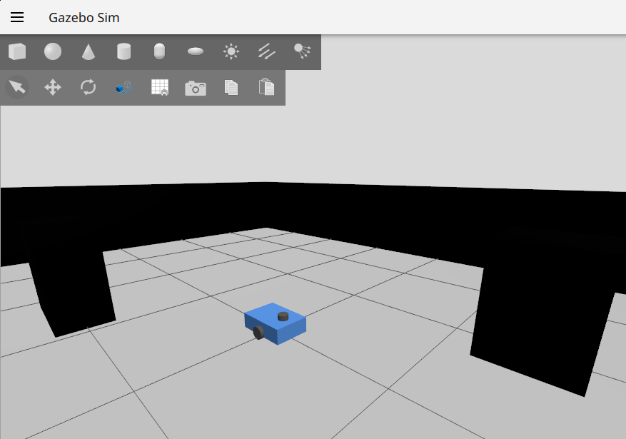
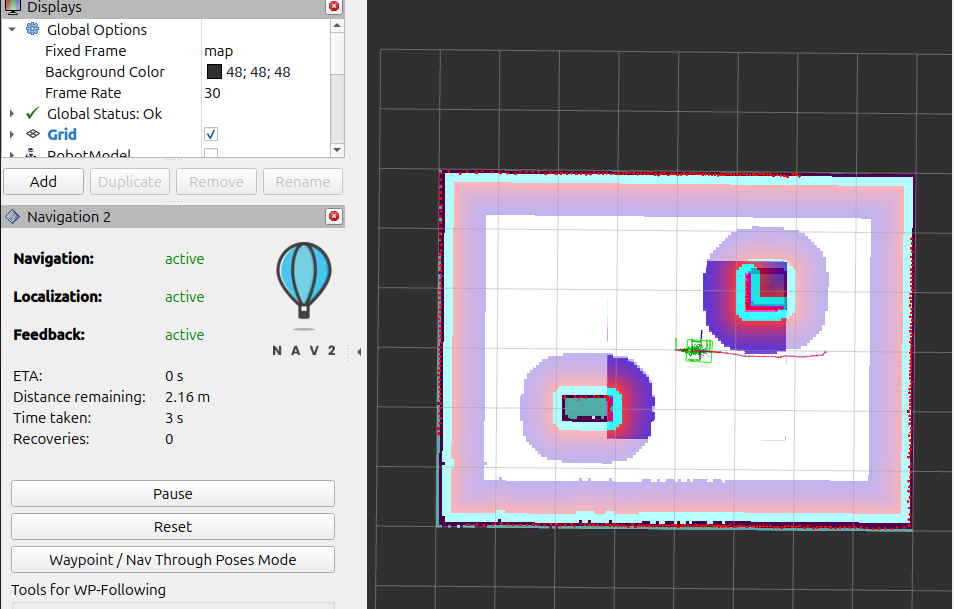
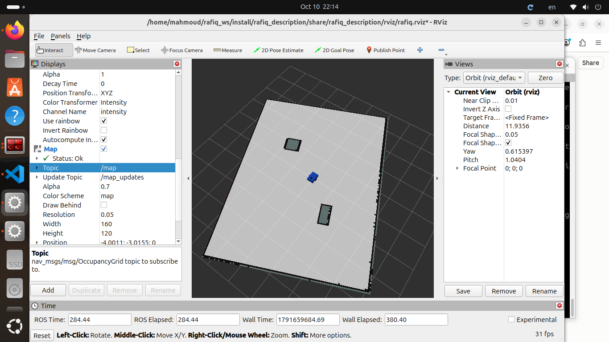
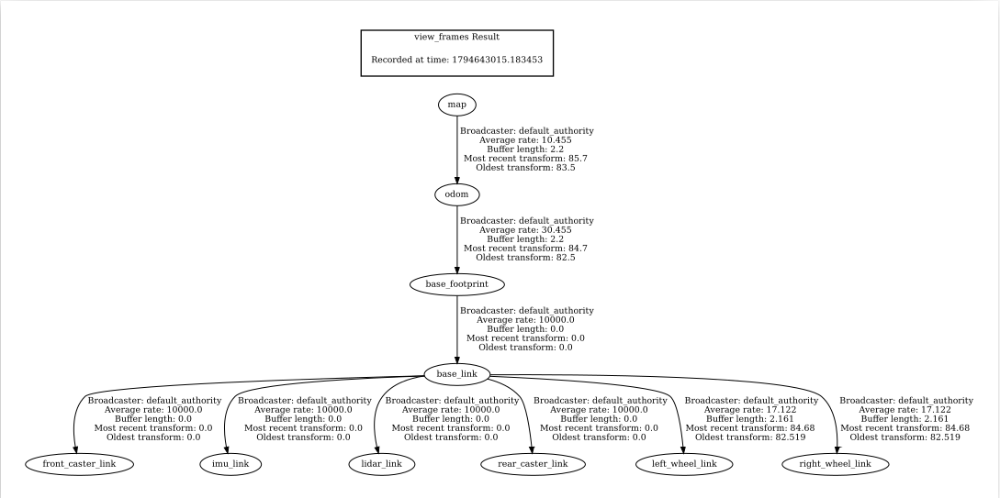

# Autonomous Mobile Robot using ROS 2 Jazzy

A differential-drive indoor delivery robot, simulated in Gazebo Harmonic and controlled with ROS 2 Jazzy.
It maps a room, localizes on the saved map, navigates with **Nav2**, and runs delivery missions
(pickup, dropoff, return home) through a custom ROS 2 action.

This project is the ROS 2 rebuild of my earlier ROS 1 project,
[Autonomous Indoor Delivery Robot](https://github.com/MahmoudHesham6/Autonomous-indoor-delivery-robot),
which used the ROS 1 navigation stack (`move_base`). The long-term goal is to grow this into a **fleet of delivery
robots managed from a web dashboard**.

> **Status:** simulation only. Single-robot delivery works end to end: the mission server accepts a `Deliver` request and drives the robot to its destination with Nav2. A multi-robot fleet manager is planned as a **separate repository**.

---

## Features

- Differential-drive robot model (URDF/Xacro) spawned in Gazebo
- Sensor fusion with **robot_localization (EKF)**: wheel odometry + IMU
- Mapping (SLAM) and localization
- Autonomous navigation with **Nav2**
- Custom **`Deliver` action interface** (`rafiq_interfaces`) and a mission server that turns delivery requests into Nav2 goals
- One-command bringup: simulation, localization, navigation, RViz and the mission server
- Separate RViz configs per phase (model, SLAM, navigation)

## Screenshots

<p align="center">
  <br>
  <em>The robot in the Gazebo world</em>
</p>

<p align="center">
  <br>
  <em>Nav2 navigating to a delivery goal in RViz</em>
</p>

<p align="center">
  <br>
  <em>Map built with slam_toolbox</em>
</p>

<p align="center">
  <br>
  <em>TF tree</em>
</p>

## Packages

| Package | Purpose |
|---|---|
| `rafiq_description` | Robot model (URDF/Xacro), Gazebo world, controllers, ROS-Gazebo bridge, EKF config, RViz configs |
| `rafiq_navigation` | Nav2 parameters, SLAM (slam_toolbox) and localization launch files, saved map |
| `rafiq_mission` | Mission server and delivery logic (`Deliver` action server, station list) |
| `rafiq_interfaces` | Custom `Deliver` action and `RobotStatus` message |
| `rafiq_bringup` | `bringup.launch.py` starts the whole system |

## Architecture

```
            +------------------+
            |  Mission server  |  Deliver action server
            +--------+---------+
                     | NavigateToPose goals
            +--------v---------+
            |       Nav2       |  planner, controller, behavior tree
            +--------+---------+
                     | cmd_vel
 +-----------+  +----v-----+   +---------------------+
 |   Gazebo  |<-+ Controller|   | EKF (robot_localiz.)|
 | simulation|  +----------+   |  wheel odom + IMU   |
 +-----+-----+                 +----------^----------+
       | sensors (lidar, IMU, odom) -------+
```

## Requirements

- Ubuntu 24.04
- ROS 2 Jazzy
- Gazebo (the version paired with Jazzy) and `ros_gz` packages
- Nav2, `robot_localization`, and `slam_toolbox`

Install dependencies from the workspace root:

```bash
rosdep install --from-paths src --ignore-src -r -y
```

## Build

```bash
mkdir -p ~/rafiq_ws/src && cd ~/rafiq_ws/src
git clone https://github.com/MahmoudHesham6/Autonomous-Mobile-Robot-using-ROS-2-Jazzy.git .
cd ~/rafiq_ws
colcon build --symlink-install
source install/setup.bash
```

## Usage

### Run everything

```bash
ros2 launch rafiq_bringup bringup.launch.py            # RViz navigation view included
ros2 launch rafiq_bringup bringup.launch.py use_rviz:=false
```
This starts, in order: Gazebo with the robot, controllers and EKF; localization on the saved map;
Nav2; the mission server. Allow about 20 seconds.

### Drive manually

Jazzy's `diff_drive_controller` expects `TwistStamped`, so teleop must publish stamped messages with simulation time:

```bash
ros2 run teleop_twist_keyboard teleop_twist_keyboard --ros-args \
  -p stamped:=true -p use_sim_time:=true \
  -r cmd_vel:=/diff_drive_controller/cmd_vel
```

### Send a delivery

```bash
ros2 action send_goal /deliver rafiq_interfaces/action/Deliver \
  "{pickup: pickup, dropoff: dropoff}" --feedback
```
The robot drives to the pickup station, waits for loading, drives to the dropoff station, waits for unloading,
and returns to `home`. A request is rejected if the robot is already busy or a station name is unknown.

## ROS 1 vs ROS 2: what changed in this rebuild

- **Nav2** replaces `move_base`, with behavior trees instead of a fixed recovery pipeline
- **Launch files** are Python instead of XML
- **Actions** are first-class and used for the mission layer
- **DDS-based communication** with QoS settings replaces the ROS 1 master
- **Lifecycle nodes** give controlled startup of the navigation stack

## Contributing

Issues and suggestions are welcome.

## License

See the [LICENSE](LICENSE) file.
